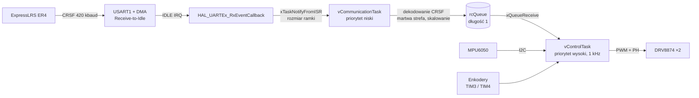
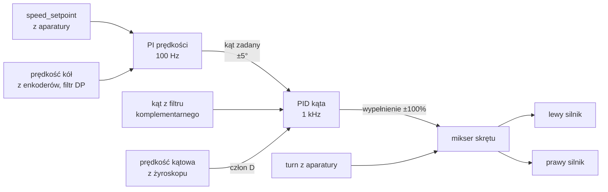

# STM32 Self-Balancing Robot

Dwukołowy robot typu odwrócone wahadło na **STM32L476RG** z **FreeRTOS**. Utrzymuje pion kaskadą dwóch regulatorów: PI prędkości kół i PD kąta. Kąt pochylenia liczy z **MPU6050** filtrem komplementarnym. Polecenia jazdy i skrętu dostaje z aparatury RC przez odbiornik **ExpressLRS** po protokole **CRSF**. Protokół CRSF jest zaimplementowany od zera, bez gotowych bibliotek.

<p align="center">
  
</p>

---

## Spis treści

- [Najważniejsze cechy](#najważniejsze-cechy)
- [Sprzęt](#sprzęt)
- [Podłączenie (pinout)](#podłączenie-pinout)
- [Architektura oprogramowania](#architektura-oprogramowania)
- [Pętla regulacji](#pętla-regulacji)
- [Estymacja kąta](#estymacja-kąta)
- [Sterowanie silnikami](#sterowanie-silnikami)
- [Odbiór CRSF z ExpressLRS](#odbiór-crsf-z-expresslrs)
- [Bezpieczeństwo](#bezpieczeństwo)
- [Struktura projektu](#struktura-projektu)
- [Budowanie i wgrywanie](#budowanie-i-wgrywanie)
- [Strojenie](#strojenie)

---

## Najważniejsze cechy

- **Pętla stabilizacji 1 kHz** w tasku FreeRTOS o wysokim priorytecie, z `vTaskDelayUntil`, więc bez dryfu okresu.
- **Regulacja kaskadowa**: zewnętrzna pętla PI prędkości kół (100 Hz) zadaje kąt pochylenia wewnętrznej pętli PD kąta (1 kHz).
- **Człon D liczony z żyroskopu**, a nie z różniczkowania uchybu, więc bez szpilek przy skokach wartości zadanej.
- **Anti-windup** przez cofnięcie całkowania przy nasyceniu wyjścia.
- **Własny parser CRSF**: synchronizacja na bajcie adresu, weryfikacja CRC-8 (DVB-S2) i rozpakowanie 16 kanałów po 11 bitów.
- **UART z DMA w trybie Receive-to-Idle**: przerwanie przychodzi raz na ramkę, a nie na każdy bajt, a przetwarzanie odbywa się w tasku, nie w ISR.
- **Failsafe**: brak danych z odbiornika przez 200 ms zeruje polecenia jazdy i skrętu.
- **Wyłączenie silników** po przewróceniu robota (pochylenie powyżej 50°).
- **Kalibracja zera żyroskopu** przy starcie (500 próbek).

---

## Sprzęt

| Element | Model | Rola |
|---|---|---|
| Mikrokontroler | STM32L476RG (Nucleo-L476RG), Cortex-M4F, 80 MHz | logika, regulacja, FreeRTOS |
| IMU | MPU6050 (I²C) | akcelerometr i żyroskop |
| Sterowniki silników | 2× TI DRV8874 (tryb PH/EN) | mostki H dla silników DC |
| Silniki | 2× DC z enkoderami kwadraturowymi | napęd i pomiar prędkości kół |
| Odbiornik RC | ExpressLRS ER4 (wyjście CRSF) | odbiór poleceń z aparatury |
| Aparatura | nadajnik z modułem ExpressLRS | sterowanie |

---

## Podłączenie (pinout)

| Sygnał | Pin STM32 | Peryferium | Uwagi |
|---|---|---|---|
| PWM lewego silnika (EN) | PA0 | TIM2_CH1 | 20 kHz |
| PWM prawego silnika (EN) | PA1 | TIM2_CH2 | 20 kHz |
| Kierunek lewego silnika (PH) | PA8 | GPIO `LEFT_MOTOR_PH` | |
| Kierunek prawego silnika (PH) | PC9 | GPIO `RIGHT_MOTOR_PH` | |
| Enkoder lewy A/B | PA6 / PA7 | TIM3_CH1 / CH2 | tryb enkodera |
| Enkoder prawy A/B | PB6 / PB7 | TIM4_CH1 / CH2 | tryb enkodera |
| MPU6050 SCL / SDA | PB8 / PB9 | I2C1 | Fast Mode, 400 kHz |
| CRSF z odbiornika (TX odbiornika) | PA10 | USART1_RX | 420000 baud, DMA1 Ch5 |
| CRSF do odbiornika (RX odbiornika) | PA9 | USART1_TX | nieużywane (brak telemetrii) |
| Konsola debug | PA2 / PA3 | USART2 | 115200 baud, przez ST-LINK VCP |

---

## Architektura oprogramowania

System działa na **FreeRTOS** (CMSIS-RTOS v2) z dwoma taskami aplikacji:



| Task | Priorytet | Okres | Zadanie |
|---|---|---|---|
| `vControlTask` | `osPriorityHigh` | 1 ms | odczyt IMU, filtr, kaskada PID, sterowanie silnikami |
| `vCommunicationTask` | `osPriorityLow` | zdarzeniowo (ramka CRSF) lub co 200 ms | odbiór i dekodowanie CRSF, wysyłka poleceń do kolejki |

### Komunikacja między taskami

- **ISR → task komunikacji**: *direct-to-task notification* (`xTaskNotifyFromISR` z `eSetValueWithOverwrite`). Wartością powiadomienia jest liczba odebranych bajtów, więc nie trzeba osobnej kolejki ani semafora.
- **Task komunikacji → task regulacji**: kolejka `rcQueue` o **długości 1**, zapisywana przez `xQueueOverwrite`. W kolejce zawsze leży tylko najświeższe polecenie (`RC_Command_t { speed, turn }`). Regulator nigdy nie dostaje zaległych, starych wychyleń drążków.

---

## Pętla regulacji

Robot jest odwróconym wahadłem: żeby stał, koła muszą stale „podjeżdżać” pod środek masy. Regulacja jest **kaskadowa**:



### Pętla wewnętrzna: kąt (1 kHz)

| Parametr | Wartość |
|---|---|
| `kp` | 10 |
| `kd` | 0.45 |
| `ki` | 0 |
| `dt` | 1 ms |
| nasycenie | ±100 (% wypełnienia PWM) |

Człon różniczkujący nie różniczkuje uchybu, tylko bierze prędkość kątową prosto z żyroskopu:

```
u = kp · (θ_zad − θ) − kd · ω_gyro + ki · ∫e dt
```

Daje to czysty sygnał D bez szumu numerycznego różniczkowania i bez szarpnięć przy zmianie kąta zadanego przez pętlę prędkości.

### Pętla zewnętrzna: prędkość (100 Hz)

Co 10 iteracji pętli kąta, czyli co 10 ms:

1. Odczyt liczników enkoderów (TIM3, TIM4), różnica względem poprzedniego odczytu. Liczniki są 16-bitowe, a różnica liczona na `int16_t`, więc przepełnienie licznika obsługuje się samo.
2. Średnia prędkość obu kół, filtr dolnoprzepustowy pierwszego rzędu (`α = 0.3`).
3. Regulator PI prędkości (`kp = 1.5`, `ki = 0.1`) liczy **kąt zadany** dla pętli wewnętrznej, nasycony do **±5°**. Członu D tu nie ma: wymagałby różniczkowania zaszumionych impulsów enkodera, a tłumienie i tak zapewnia pętla kąta.

Żeby pojechać do przodu, robot musi się najpierw pochylić do przodu. Pętla prędkości robi dokładnie to: zamiast bezpośrednio kręcić kołami, przechyla robota, a pętla kąta sama za tym pochyleniem „podjeżdża”. Ta sama pętla przy zerowym poleceniu likwiduje powolne odjeżdżanie robota, które zostałoby przy samej regulacji kąta.

### Anti-windup

Gdy wyjście regulatora wchodzi w nasycenie, ostatni przyrost całki jest cofany (*conditional integration*). Całka nie rośnie w nieskończoność, kiedy siłowniki i tak dają już maksimum.

### Mikser skrętu

```
lewy  = u − turn
prawy = u + turn
```

Jeśli dodanie skrętu wypchnęłoby któreś koło poza ±100%, skręt jest pomijany. **Priorytet ma utrzymanie pionu**, a nie wykonanie skrętu.

---

## Estymacja kąta

Kąt pochylenia (oś Y) z **filtru komplementarnego**:

```
θ_acc = atan2(a_x, √(a_y² + a_z²))
θ     = α · (θ_prev − ω_y · dt) + (1 − α) · θ_acc
```

| Parametr | Wartość | Znaczenie |
|---|---|---|
| `α` | 0.998 | zaufanie do żyroskopu |
| `dt` | 1 ms | okres pętli |
| stała czasowa | ≈ 0.5 s | `τ = α·dt / (1 − α)` |

- **Żyroskop** dobrze śledzi szybkie zmiany, ale całkowany dryfuje.
- **Akcelerometr** daje absolutny kąt względem grawitacji, ale jest zaszumiony i zakłócany przyspieszeniami robota.

Filtr bierze z żyroskopu wysokie częstotliwości, a z akcelerometru tylko składową wolnozmienną, która koryguje dryf.

### Konfiguracja MPU6050

| Rejestr | Ustawienie |
|---|---|
| zakres akcelerometru | ±2 g (16384 LSB/g) |
| zakres żyroskopu | ±500 °/s (65.5 LSB/(°/s)) |
| DLPF (`CONFIG`) | 3, ok. 44 Hz |
| odczyt | 14 bajtów jednym transferem I²C od `0x3B` |

Przy starcie liczone jest **zero żyroskopu** ze średniej z 500 próbek. **Robot musi wtedy stać nieruchomo.**

---

## Sterowanie silnikami

Sterownik **DRV8874** pracuje w trybie **PH/EN**:

- **EN** to PWM z TIM2: 80 MHz / 4000 = **20 kHz**, poza zakresem słyszalnym.
- **PH** to pin GPIO z kierunkiem obrotu.

Wejście `DRV8874_set_*_speed()` to wypełnienie w procentach, od −100 do +100. Przed wysłaniem na PWM wartość przechodzi przez:

| Zakres wejścia | Wynik | Po co |
|---|---|---|
| \|u\| < 2 | 0 | martwa strefa, bez brzęczenia silników w pionie |
| 2 ≤ \|u\| < 5 | ±5 | kompensacja tarcia statycznego, bo silnik ruszy dopiero od pewnego progu |
| \|u\| > 100 | ±100 | nasycenie |

---

## Odbiór CRSF z ExpressLRS

### Warstwa fizyczna

- **USART1, 420000 baud, 8N1**, pin PA10.
- **DMA w trybie Receive-to-Idle** (`HAL_UARTEx_ReceiveToIdle_DMA`). Bajty trafiają do bufora bez udziału CPU, a przerwanie przychodzi dopiero, gdy linia przestaje nadawać, czyli po całej ramce.

### Format ramki RC (`RC_CHANNELS_PACKED`)

| Bajt | Zawartość |
|---|---|
| 0 | adres: `0xC8` (flight controller) |
| 1 | długość: `24` (typ + payload + CRC) |
| 2 | typ: `0x16` (RC channels packed) |
| 3–24 | 16 kanałów × 11 bitów = 22 bajty, little-endian |
| 25 | CRC-8 |

### Dekodowanie (`crsf.c`)

1. **Synchronizacja**: przeszukanie bufora w poszukiwaniu `0xC8`, długości `24` i typu `0x16`. Bufor DMA nie zawsze zaczyna się na początku ramki.
2. **CRC-8 DVB-S2** (wielomian `0xD5`, tablica 256 elementów) liczony z bajtów od typu do końca payloadu i porównywany z ostatnim bajtem ramki.
3. **Rozpakowanie kanałów**: dla kanału `i` przesunięcie bitowe to `i · 11`. Z payloadu czytane są 4 bajty jako słowo 32-bitowe, przesunięte o `bit_offset % 8` i zamaskowane `0x7FF`.

### Mapowanie na polecenia

Wartości kanałów CRSF: **172** (min), **992** (środek), **1811** (max).

| Kanał | Polecenie | Zakres po skalowaniu |
|---|---|---|
| CH1 | `turn` (skręt) | ±30 |
| CH2 | `speed_setpoint` (jazda) | ±5 (impulsy enkodera / 10 ms) |

```
wartość = (kanał − 992) · MAX / 819     # martwa strefa ±8 wokół środka
```

---

## Bezpieczeństwo

| Sytuacja | Reakcja |
|---|---|
| Brak danych z odbiornika przez 200 ms | `speed = 0`, `turn = 0`: robot stoi w miejscu i dalej balansuje |
| Uszkodzona ramka (zły CRC) | ignorowana, ostatnie poprawne polecenie zostaje |
| Pochylenie > 50° (przewrócenie) | silniki wyłączone na stałe, do resetu |
| Błąd odczytu IMU | pętla korzysta z ostatniego poprawnego kąta |

Failsafe działa przez timeout `xTaskNotifyWait`: jeśli przez 200 ms nie przyjdzie żadne powiadomienie z przerwania UART, task komunikacji sam wpisuje do kolejki zera.

---

## Struktura projektu

```
Core/
├── Inc/
│   ├── communication_task.h   # task CRSF, deklaracja rcQueue
│   ├── control_task.h         # task regulacji
│   ├── crsf.h                 # typy kanałów RC, dekoder
│   ├── DRV8874.h              # sterownik silników
│   ├── filters.h              # filtr komplementarny
│   ├── mpu6050.h              # IMU
│   ├── pid.h                  # regulator PID
│   ├── RC_Command.h           # struktura polecenia { speed, turn }
│   └── FreeRTOSConfig.h
└── Src/
    ├── main.c                 # init peryferiów, tworzenie tasków i kolejki
    ├── control_task.c         # pętla 1 kHz: IMU, kaskada PID, silniki
    ├── communication_task.c   # odbiór UART/DMA, failsafe, skalowanie
    ├── crsf.c                 # synchronizacja, CRC-8, rozpakowanie kanałów
    ├── DRV8874.c              # PWM + PH, martwa strefa, nasycenie
    ├── mpu6050.c              # init, kalibracja żyroskopu, odczyt I²C
    ├── filters.c              # filtr komplementarny
    └── pid.c                  # PID z D z pomiaru i anti-windupem
```

Konfiguracja peryferiów i FreeRTOS jest w `robocik.ioc` (STM32CubeMX).

---

## Budowanie i wgrywanie

**Wymagania:** STM32CubeIDE 1.16+ i płytka Nucleo-L476RG (lub STM32L476RG z ST-LINK).

1. `File → Import → Existing Projects into Workspace` i wybierz katalog repozytorium.
2. `Project → Build Project`.
3. `Run → Debug` wgrywa przez ST-LINK.
4. Konsola debug: port COM ST-LINK, **115200 baud**.

**Przy starcie** robot musi stać nieruchomo (najlepiej podparty w pionie) przez około 2 sekundy, bo trwa wtedy kalibracja żyroskopu.

### Ustawienia odbiornika ExpressLRS

- Protokół wyjściowy: **CRSF**.
- Baud odbiornika: **420000** (domyślne dla ELRS).
- Aparatura w trybie kanałów **AETR**.

---

## Strojenie

Kolejność, która sprawdza się przy balancerach:

1. **Tylko pętla kąta** (pętla prędkości wyłączona, `angle_setpoint = 0`): zwiększaj `kp`, aż robot zacznie oscylować, potem dodawaj `kd`, aż oscylacje znikną.
2. **Pętla prędkości**: zacznij od małego `kp`, aż robot przestanie odjeżdżać. `ki` likwiduje powolny dryf w jedną stronę.
3. **Nasycenie kąta zadanego (±5°)** ogranicza, jak mocno pętla prędkości może przechylić robota, czyli w praktyce maksymalne przyspieszenie.
4. **`MAX_SPEED` i `MAX_TURN`** w `communication_task.c` ustawiają czułość drążków.
