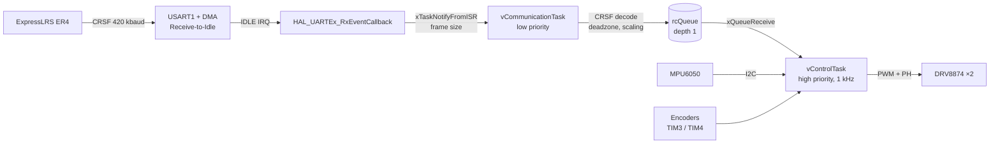
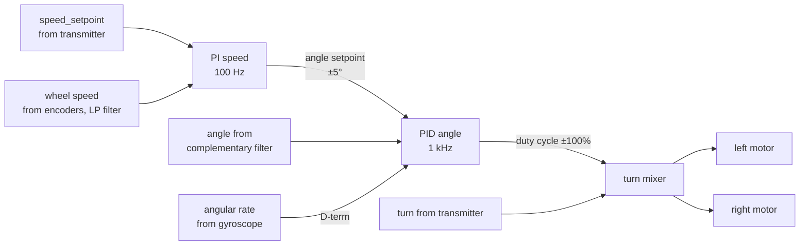

# STM32 Self-Balancing Robot

A two-wheeled inverted-pendulum robot built on the **STM32L476RG** with **FreeRTOS**. It stays upright using a cascade of two controllers: a PI wheel-speed loop and a PD tilt-angle loop. Tilt angle is estimated from an **MPU6050** via a complementary filter. Drive and steering commands come from an RC transmitter through an **ExpressLRS** receiver over the **CRSF** protocol. The CRSF protocol is implemented from scratch, with no third-party libraries.

<p align="center">
  
</p>

---

## Table of Contents

- [Key Features](#key-features)
- [Hardware](#hardware)
- [Wiring (Pinout)](#wiring-pinout)
- [Software Architecture](#software-architecture)
- [Control Loop](#control-loop)
- [Angle Estimation](#angle-estimation)
- [Motor Drive](#motor-drive)
- [CRSF Reception from ExpressLRS](#crsf-reception-from-expresslrs)
- [Safety](#safety)
- [Project Structure](#project-structure)
- [Building and Flashing](#building-and-flashing)
- [Tuning](#tuning)

---

## Key Features

- **1 kHz stabilization loop** in a high-priority FreeRTOS task, using `vTaskDelayUntil` for zero period drift.
- **Cascade control**: an outer PI wheel-speed loop (100 Hz) sets the tilt angle reference for an inner PD angle loop (1 kHz).
- **D-term computed from the gyroscope**, not from error differentiation, so no spikes on setpoint changes.
- **Anti-windup** via integration rollback when the output saturates.
- **Custom CRSF parser**: sync on the address byte, CRC-8 (DVB-S2) verification, and unpacking of 16 × 11-bit channels.
- **UART with DMA in Receive-to-Idle mode**: one interrupt per frame instead of per byte; processing runs in a task, not in the ISR.
- **Failsafe**: no receiver data for 200 ms zeros out the drive and steering commands.
- **Motor shutdown** when the robot tips over (tilt exceeds 50°).
- **Gyroscope zero calibration** at startup (500 samples).

---

## Hardware

| Component | Model | Role |
|---|---|---|
| Microcontroller | STM32L476RG (Nucleo-L476RG), Cortex-M4F, 80 MHz | logic, control, FreeRTOS |
| IMU | MPU6050 (I²C) | accelerometer and gyroscope |
| Motor drivers | 2× TI DRV8874 (PH/EN mode) | H-bridges for DC motors |
| Motors | 2× DC with quadrature encoders | drive and wheel speed measurement |
| RC receiver | ExpressLRS ER4 (CRSF output) | receives commands from transmitter |
| Transmitter | RC transmitter with ExpressLRS module | control |

---

## Wiring (Pinout)

| Signal | STM32 Pin | Peripheral | Notes |
|---|---|---|---|
| Left motor PWM (EN) | PA0 | TIM2_CH1 | 20 kHz |
| Right motor PWM (EN) | PA1 | TIM2_CH2 | 20 kHz |
| Left motor direction (PH) | PA8 | GPIO `LEFT_MOTOR_PH` | |
| Right motor direction (PH) | PC9 | GPIO `RIGHT_MOTOR_PH` | |
| Left encoder A/B | PA6 / PA7 | TIM3_CH1 / CH2 | encoder mode |
| Right encoder A/B | PB6 / PB7 | TIM4_CH1 / CH2 | encoder mode |
| MPU6050 SCL / SDA | PB8 / PB9 | I2C1 | Fast Mode, 400 kHz |
| CRSF from receiver (RX TX pin) | PA10 | USART1_RX | 420000 baud, DMA1 Ch5 |
| CRSF to receiver (RX RX pin) | PA9 | USART1_TX | unused (no telemetry) |
| Debug console | PA2 / PA3 | USART2 | 115200 baud, via ST-LINK VCP |

---

## Software Architecture

The system runs on **FreeRTOS** (CMSIS-RTOS v2) with two application tasks:



| Task | Priority | Period | Responsibility |
|---|---|---|---|
| `vControlTask` | `osPriorityHigh` | 1 ms | IMU read, filter, PID cascade, motor drive |
| `vCommunicationTask` | `osPriorityLow` | event-driven (CRSF frame) or every 200 ms | CRSF reception and decoding, command forwarding to queue |

### Inter-Task Communication

- **ISR → communication task**: *direct-to-task notification* (`xTaskNotifyFromISR` with `eSetValueWithOverwrite`). The notification value carries the number of bytes received, so no separate queue or semaphore is needed.
- **Communication task → control task**: a queue `rcQueue` of **depth 1**, written via `xQueueOverwrite`. The queue always holds only the most recent command (`RC_Command_t { speed, turn }`). The controller never gets stale, outdated stick positions.

---

## Control Loop

The robot is an inverted pendulum: to stay upright the wheels must constantly "drive under" the center of mass. The control is **cascaded**:



### Inner Loop: Angle (1 kHz)

| Parameter | Value |
|---|---|
| `kp` | 10 |
| `kd` | 0.45 |
| `ki` | 0 |
| `dt` | 1 ms |
| saturation | ±100 (% PWM duty) |

The derivative term does not differentiate the error; instead it takes the angular rate straight from the gyroscope:

```
u = kp · (θ_ref − θ) − kd · ω_gyro + ki · ∫e dt
```

This gives a clean D signal with no numerical differentiation noise and no jerks when the angle setpoint changes from the speed loop.

### Outer Loop: Speed (100 Hz)

Every 10 iterations of the angle loop, i.e. every 10 ms:

1. Read encoder counters (TIM3, TIM4) and compute the difference from the previous reading. The counters are 16-bit and the difference is computed on `int16_t`, so counter overflow is handled automatically.
2. Average speed of both wheels, first-order low-pass filter (`α = 0.3`).
3. PI speed controller (`kp = 1.5`, `ki = 0.1`) computes the **angle setpoint** for the inner loop, clamped to **±5°**. There is no D-term here: it would require differentiating noisy encoder pulses, and damping is already provided by the angle loop.

To drive forward the robot must first lean forward. The speed loop does exactly that: instead of spinning the wheels directly, it tilts the robot, and the angle loop "catches up" with the tilt. The same loop, when commanded zero speed, corrects the slow drift that would remain with angle control alone.

### Anti-Windup

When the controller output saturates, the last integrator increment is rolled back (*conditional integration*). The integral does not grow unbounded while the actuators are already at their limit.

### Turn Mixer

```
left  = u − turn
right = u + turn
```

If adding the turn command would push either motor beyond ±100%, the turn is ignored. **Staying upright takes priority** over executing a turn.

---

## Angle Estimation

Tilt angle (Y-axis) from a **complementary filter**:

```
θ_acc = atan2(a_x, √(a_y² + a_z²))
θ     = α · (θ_prev − ω_y · dt) + (1 − α) · θ_acc
```

| Parameter | Value | Meaning |
|---|---|---|
| `α` | 0.998 | trust in the gyroscope |
| `dt` | 1 ms | loop period |
| time constant | ≈ 0.5 s | `τ = α·dt / (1 − α)` |

- The **gyroscope** tracks fast changes well but drifts when integrated.
- The **accelerometer** gives an absolute angle relative to gravity but is noisy and disturbed by the robot's accelerations.

The filter takes the high frequencies from the gyroscope and only the slow-varying component from the accelerometer, which corrects the drift.

### MPU6050 Configuration

| Register | Setting |
|---|---|
| accelerometer range | ±2 g (16384 LSB/g) |
| gyroscope range | ±500 °/s (65.5 LSB/(°/s)) |
| DLPF (`CONFIG`) | 3, approx. 44 Hz |
| read | 14 bytes in a single I²C transfer from `0x3B` |

At startup, the **gyroscope zero offset** is computed as the average of 500 samples. **The robot must remain stationary during this time.**

---

## Motor Drive

The **DRV8874** driver operates in **PH/EN mode**:

- **EN** is the PWM output from TIM2: 80 MHz / 4000 = **20 kHz**, above the audible range.
- **PH** is a GPIO pin that sets the direction of rotation.

The input to `DRV8874_set_*_speed()` is a duty cycle in percent, from −100 to +100. Before being sent to the PWM, the value passes through:

| Input range | Result | Purpose |
|---|---|---|
| \|u\| < 2 | 0 | deadzone, prevents motor buzzing while standing |
| 2 ≤ \|u\| < 5 | ±5 | static friction compensation, motor won't spin below a certain threshold |
| \|u\| > 100 | ±100 | saturation |

---

## CRSF Reception from ExpressLRS

### Physical Layer

- **USART1, 420000 baud, 8N1**, pin PA10.
- **DMA in Receive-to-Idle mode** (`HAL_UARTEx_ReceiveToIdle_DMA`). Bytes are transferred to the buffer without CPU involvement; an interrupt fires only when the line goes idle, i.e. after a complete frame.

### RC Frame Format (`RC_CHANNELS_PACKED`)

| Byte | Content |
|---|---|
| 0 | address: `0xC8` (flight controller) |
| 1 | length: `24` (type + payload + CRC) |
| 2 | type: `0x16` (RC channels packed) |
| 3–24 | 16 channels × 11 bits = 22 bytes, little-endian |
| 25 | CRC-8 |

### Decoding (`crsf.c`)

1. **Synchronization**: scan the buffer for `0xC8`, length `24`, and type `0x16`. The DMA buffer does not always start at the beginning of a frame.
2. **CRC-8 DVB-S2** (polynomial `0xD5`, 256-entry lookup table) computed over the bytes from the type field through the end of the payload and compared to the last byte of the frame.
3. **Channel unpacking**: for channel `i`, the bit offset is `i · 11`. Four bytes are read from the payload as a 32-bit word, shifted by `bit_offset % 8`, and masked with `0x7FF`.

### Mapping to Commands

CRSF channel values: **172** (min), **992** (center), **1811** (max).

| Channel | Command | Scaled range |
|---|---|---|
| CH1 | `turn` (steering) | ±30 |
| CH2 | `speed_setpoint` (drive) | ±5 (encoder pulses / 10 ms) |

```
value = (channel − 992) · MAX / 819     # deadzone ±8 around center
```

---

## Safety

| Condition | Response |
|---|---|
| No receiver data for 200 ms | `speed = 0`, `turn = 0`: robot stands in place and keeps balancing |
| Corrupted frame (bad CRC) | ignored, last valid command is kept |
| Tilt > 50° (tip-over) | motors disabled permanently until reset |
| IMU read error | loop uses the last valid angle |

Failsafe works via the `xTaskNotifyWait` timeout: if no UART interrupt notification arrives within 200 ms, the communication task writes zeros to the queue on its own.

---

## Project Structure

```
Core/
├── Inc/
│   ├── communication_task.h   # CRSF task, rcQueue declaration
│   ├── control_task.h         # control task
│   ├── crsf.h                 # RC channel types, decoder
│   ├── DRV8874.h              # motor driver
│   ├── filters.h              # complementary filter
│   ├── mpu6050.h              # IMU
│   ├── pid.h                  # PID controller
│   ├── RC_Command.h           # command struct { speed, turn }
│   └── FreeRTOSConfig.h
└── Src/
    ├── main.c                 # peripheral init, task and queue creation
    ├── control_task.c         # 1 kHz loop: IMU, PID cascade, motors
    ├── communication_task.c   # UART/DMA reception, failsafe, scaling
    ├── crsf.c                 # sync, CRC-8, channel unpacking
    ├── DRV8874.c              # PWM + PH, deadzone, saturation
    ├── mpu6050.c              # init, gyroscope calibration, I²C read
    ├── filters.c              # complementary filter
    └── pid.c                  # PID with D-from-measurement and anti-windup
```

Peripheral and FreeRTOS configuration is in `robocik.ioc` (STM32CubeMX).

---

## Building and Flashing

**Requirements:** STM32CubeIDE 1.16+ and a Nucleo-L476RG board (or an STM32L476RG with ST-LINK).

1. `File → Import → Existing Projects into Workspace` and select the repository directory.
2. `Project → Build Project`.
3. `Run → Debug` flashes via ST-LINK.
4. Debug console: ST-LINK COM port, **115200 baud**.

**At startup** the robot must remain stationary (ideally propped upright) for about 2 seconds while the gyroscope calibration runs.

### ExpressLRS Receiver Settings

- Output protocol: **CRSF**.
- Receiver baud rate: **420000** (ELRS default).
- Transmitter channel order: **AETR**.

---

## Tuning

Recommended order for balancing robots:

1. **Angle loop only** (speed loop disabled, `angle_setpoint = 0`): increase `kp` until the robot starts oscillating, then increase `kd` until the oscillations disappear.
2. **Speed loop**: start with a small `kp` until the robot stops drifting away. `ki` eliminates slow drift in one direction.
3. **Angle setpoint saturation (±5°)** limits how much the speed loop can tilt the robot, effectively capping the maximum acceleration.
4. **`MAX_SPEED` and `MAX_TURN`** in `communication_task.c` set the stick sensitivity.
